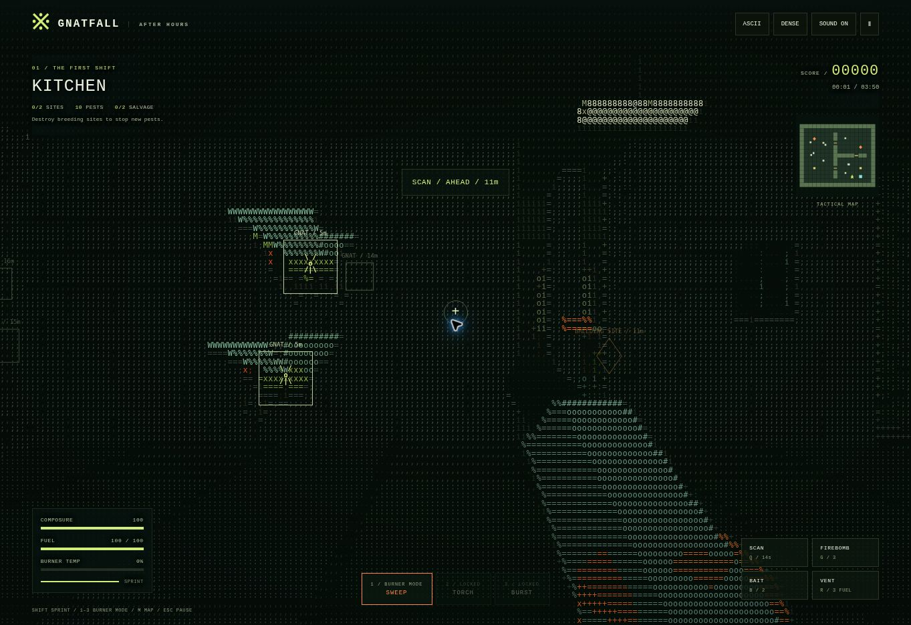

# GNATFALL — After Hours

**[Play on GitHub Pages](https://obsidianmango.github.io/ObsidianMango/gnatfall/)**

A first-person 3D ASCII pest-control campaign. Six locations, living infestations, equipment progression, exploration, and one very bad idea.

## The campaign

1. **Midnight Kitchen** — learn to contain gnats around drains and waste.
2. **Pantry After Dark** — spoiled stores, shelving, fruit flies, and moths.
3. **The Glasshouse** — planted aisles, standing water, and diving mosquitoes.
4. **Trash Night** — a loading yard with houseflies and explosive drums.
5. **Something in the Rafters** — an attic with moths, wasps, and timber beams.
6. **The Rooftop Queen** — destroy satellite nests, then fight a queen that calls escorts as her health falls.

Each mission requires destroying every breeding site, clearing the surviving pests, and returning to an extraction pad. Active sites produce reinforcements. Three medals reward completion, finishing within par time, and finding all salvage. Completed shifts award credits for five permanent equipment upgrades. Mission unlocks, credits, equipment, medals, and graphics settings save in the browser on that device. A shift in progress restarts if the page reloads.

## Equipment and interactions

- **Sweep burner:** a wide cone for swarms.
- **Precision torch:** unlocks after the kitchen; higher damage and longer reach.
- **Pressure burst:** unlocks after the pantry; explosive projectiles.
- **Firebombs:** area damage and burning ground. Explosions can hurt the player.
- **Bait:** draws nearby pests for 18 seconds.
- **Scan:** reveals targets for seven seconds, with a recharge period.
- **Quick vent:** trades three fuel for rapid cooling.
- **Supply stations:** unlimited fuel refills and one first-aid use per mission, preventing fuel softlocks.
- **Doors:** open new rooms, animate, and block movement and fire while closed.
- **Zappers:** activate, then lure pests into their operating radius.
- **Crates:** burn them to find supplies.
- **Red drums:** explosive, with nearby chain reactions.

Gnats swarm, fruit flies dodge flame, mosquitoes dive, houseflies land between flights, moths seek lights, and wasps strafe and fire projectiles. Pests navigate toward reachable openings when solid geometry blocks their path. Select Relaxed, Standard, or Relentless difficulty before starting a shift.

## Controls

| Action | Desktop | Phone |
| --- | --- | --- |
| Move / look | WASD / mouse or arrow keys | Left joystick / swipe scene |
| Burn | Hold left click or Space | Hold BURN |
| Sprint | Hold Shift | Hold SPRINT |
| Interact | E | Context button |
| Scan | Q | SCAN |
| Firebomb | G or right click | FIREBOMB |
| Bait | B | BAIT |
| Quick vent | R | VENT |
| Burner modes | 1–3 | CHANGE MODE |
| Tactical map | M | Tap radar |
| Pause | Escape / P | Ⅱ |

Gamepads support sticks for movement/look, RT to fire, A to interact, LB to scan, RB for firebombs, B for bait, Y to change burner mode, left-stick click to sprint, and Start to pause. Start the initial mission through the menu.

## Graphics and runtime

Detailed colored ASCII is the default. Optional solid and pixel views use the same world and gameplay. A WebGL renderer creates the scene, then maps its lighting and colors to a character atlas. A complete software 3D rasterizer supplies the same game when WebGL is unavailable. Animated insect bodies, wings, equipment, nests, effects, rooms, and props are generated in code; there are no external assets, libraries, CDN dependencies, or build step.

Serve this directory with any static HTTP server or GitHub Pages. `index.html` loads `content.js`, `render.js`, `game.js`, and `app.js`. The files separate mission content, rendering, game rules, and interface/input/audio.

## Validation

Run `node tests/game.test.cjs`.

Regression checks cover all six maps' objective access, shared solid geometry, flame occlusion and damage, doors, fuel/heat, station refills, first-aid limits, crates, the queen's arrival and reinforcements, extraction reward idempotence, mission/weapon unlocks, three-medal scoring, upgrade purchases and persistence, defeat/retry, pause safety, gadgets, and mixed-input simulations across every location.

Browser checks cover starting missions, ASCII rendering, scanner and burner controls, tactical map, pause, field guide, armory restrictions, graphics switching, and a 390-pixel phone layout. The QA browser uses the software rendering fallback; the hardware WebGL path and physical phone/gamepad performance still need device playtesting.
